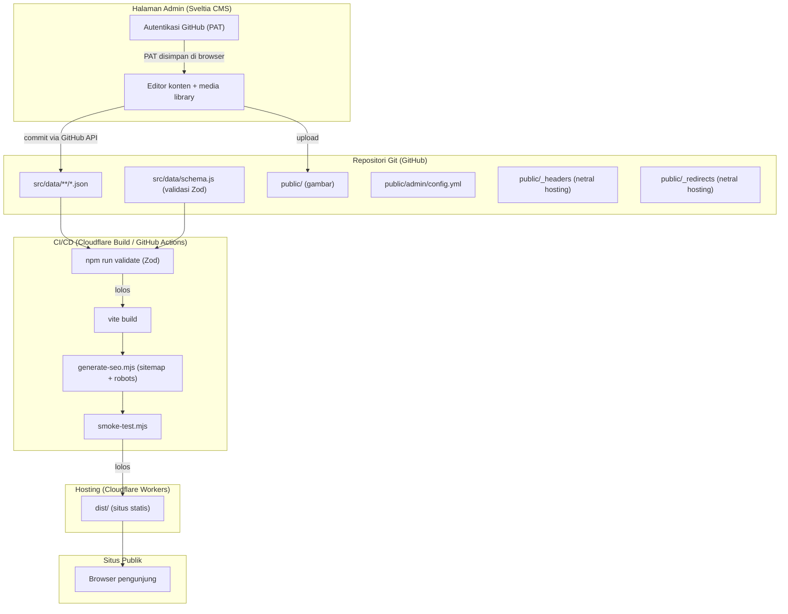
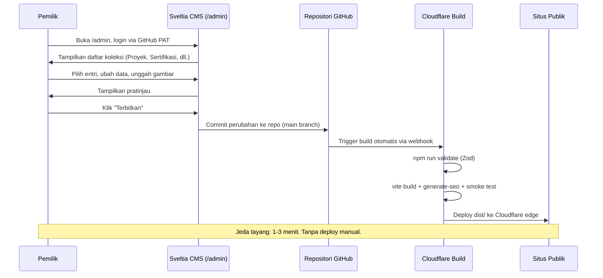
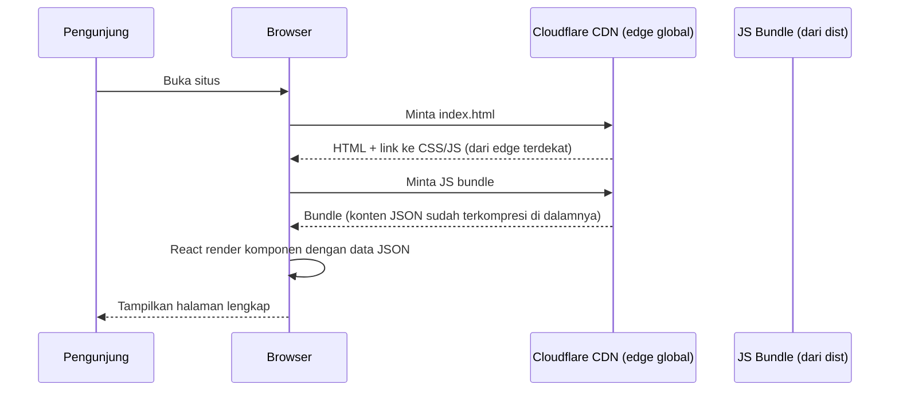
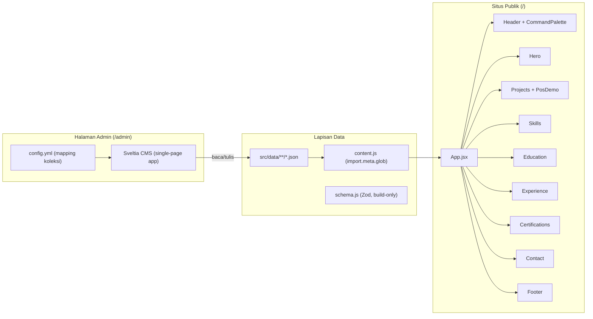
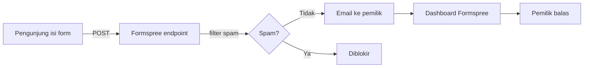
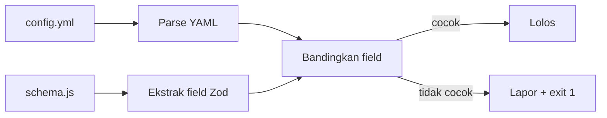

# Arsitektur Sistem: Portofolio Dewa Bintang Nugroho

Dokumen ini menjelaskan arsitektur komponen, alur data, pilihan CMS, dan rencana hosting. Status: perancangan aktif.

Revisi Tahap B: hosting utama diganti ke Cloudflare Workers Static Assets, header keamanan dipindah ke file netral hosting (`_headers`), environment variable didokumentasikan, pemicu deploy Cloudflare dijelaskan, tabel biaya ditambahkan.

---

## 1. Diagram Komponen



## 2. Alur Data

### Alur publikasi konten (pemilik mengedit)



### Alur baca konten (pengunjung)



Catatan: konten ter-embed di JS bundle hasil build. Tidak ada panggilan API saat runtime.

## 3. Pembagian Frontend



### Lapisan data publik

Situs publik tetap static. Konten diimpor dari file JSON saat build oleh Vite, lalu terkompresi ke bundle JS. Saat runtime, tidak ada panggilan API. Lapisan data terdiri dari:

- `src/data/content.js`: memuat seluruh file JSON lewat `import.meta.glob` dan merakitnya jadi satu objek.
- `src/data/schema.js`: skema Zod, hanya dipakai saat build (`npm run validate`), tidak masuk bundle.
- `src/data/**/*.json`: file konten per entri, bisa ditambah/edit/hapus lewat CMS.

### Lapisan admin

- `public/admin/index.html`: halaman yang memuat Sveltia CMS dari CDN.
- `public/admin/config.yml`: konfigurasi koleksi, field, dan autentikasi.
- Sveltia CMS berjalan sebagai single-page app terpisah dari situs publik. Buka di `/admin/`.

## 4. Perbandingan Opsi Pengelolaan Konten

### 4.1 Sveltia CMS (Git-based, JSON di repo)

Sveltia CMS adalah penerus modern Decap CMS (dulunya Netlify CMS). Berjalan sebagai single-page app dari CDN, mengedit file di repo Git lewat autentikasi. Sumber: [GitHub Sveltia CMS](https://github.com/sveltia/sveltia-cms), [Jamstack](https://jamstack.org/headless-cms/sveltia-cms/).

### 4.2 Supabase (database + auth + storage)

Supabase menyediakan PostgreSQL, autentikasi, storage, dan REST/GraphQL API. Aplikasi fetch konten dari API saat runtime. Sumber: [Supabase Pricing](https://supabase.com/pricing).

### 4.3 Sanity (headless CMS, free tier)

Sanity menyediakan Sanity Studio (admin UI siap pakai) dan content lake (database terdistribusi dengan CDN). Aplikasi fetch konten lewat GROQ atau API. Sumber: [Sanity Pricing](https://www.sanity.io/pricing).

### 4.4 TinaCMS (Git-based + visual editing)

TinaCMS mengedit konten langsung di tampilan situs (visual editing), menyimpan ke repo Git, dan menyinkronkan via Tina Cloud. Sumber: [TinaCMS](https://tina.io).

### Tabel Perbandingan

| Kriteria | Sveltia CMS | Supabase | Sanity | TinaCMS |
|----------|-------------|----------|--------|---------|
| Biaya | Rp 0 | Rp 0 (free tier) | Rp 0 (free tier) | Rp 0 (free tier, terbatas) |
| Limit free tier | Tidak ada (open source) | 500 MB DB, 1 GB storage, 50k MAU, project pause setelah 1 minggu idle | 500k API request/bln, 10 GB aset, 3 user | 2 user, 5k node, butuh Tina Cloud untuk sync |
| Admin UI | Bawaan, siap pakai | Harus dibangun sendiri | Sanity Studio, siap pakai | Visual editor di situs + dashboard |
| Format konten | JSON/Markdown di repo | Tabel PostgreSQL (API) | Content lake (API + GROQ) | JSON/Markdown di repo + Tina Cloud |
| Runtime dependency | Tidak ada (static) | Ya (fetch API saat load) | Ya (fetch API saat load) | Tidak ada (static, kecuali visual editor) |
| SEO | Bagus (konten di bundle) | Kurang (konten fetch runtime, tidak di HTML) | Kurang (sama, kecuali pakai SSR/ISR) | Bagus (konten di repo) |
| Performa publik | Terbaik (static, tidak ada API call) | Tergantung latensi API + perlu loading state | Tergantung latensi API (CDN Sanity membantu) | Terbaik (static) |
| Build ulang diperlukan | Ya, otomatis via CI | Tidak (instan) | Tidak (instan) | Ya, otomatis via CI |
| Vendor lock-in | Rendah (konten di repo, CMS open source) | Sedang (PostgreSQL portable, tapi API Supabase spesifik) | Tinggi (GROQ + content lake proprietary) | Sedang (format Tina di repo, tapi Tina Cloud proprietary) |
| Kecocokan React + Vite | Sangat cocok (konten JSON diimpor saat build) | Cocok (perlu @supabase/supabase-js, loading state, error handling) | Cocok (perlu @sanity/client atau next.js untuk SSR) | Cocok (perlu @tinacms, lebih cocok dengan Next.js) |
| Kompleksitas setup | Rendah (tambah config.yml + index.html) | Tinggi (desain DB, RLS, auth, admin UI, API client) | Sedang (define schema Sanity, setup Studio, query GROQ) | Sedang (define schema Tina, setup Tina Cloud, integrasi) |
| Upload gambar | Media library bawaan (simpan ke repo) | Supabase Storage | Sanity asset CDN | Media library bawaan |
| Keamanan | Autentikasi via GitHub (PAT atau OAuth). Tidak ada API publik. | RLS wajib. API publik untuk baca konten. | API key. Query publik dengan batasan. | Autentikasi via Tina Cloud. |
| Risiko downtime | Tidak ada (situs static terus jalan walau CMS down) | Project pause 1 minggu idle = situs blank | Tidak ada (CDN, tapi API tetap dibutuhkan saat load) | Tidak ada (situs static terus jalan) |
| Bahasa Indonesia UI | Ya (25+ bahasa termasuk Indonesia) | Tidak (admin buatan sendiri) | Sebagian (customizable) | Tidak |
| Mobile support | Ya (Sveltia perbaikan utama vs Decap) | Tergantung implementasi | Ya | Ya |

## 5. Rekomendasi: Sveltia CMS

### Alasan

1. **Memanfaatkan struktur yang sudah ada.** Konten sudah berupa JSON dan tervalidasi Zod. Sveltia CMS mengedit file JSON di repo, jadi skema dan proses validasi tidak perlu dirombak.

2. **Situs tetap static.** Konten ter-embed di JS bundle saat build. Tidak ada API runtime. Hasil: paling cepat untuk pengunjung, SEO terbaik, dan tidak ada risiko "situs blank" jika layanan eksternal down.

3. **Biaya nol tanpa batas praktis.** Sveltia CMS open source dan gratis. Hosting di Cloudflare Workers free tier. Tidak ada limit request untuk aset statis, tidak ada limit dokumen.

4. **Admin UI siap pakai.** Login, daftar koleksi, form tambah/edit, upload gambar, pratinjau, dan hapus dengan konfirmasi sudah disediakan.

5. **Vendor lock-in rendah.** Konten ada di repo Git. Jika Sveltia CMS bermasalah, bisa ganti ke Decap CMS (format config.yml kompatibel) tanpa migrasi data.

6. **Bahasa Indonesia.** Sveltia CMS mendukung 25+ bahasa termasuk Indonesia.

7. **Publish otomatis tanpa deploy manual.** CMS commit ke repo, Cloudflare Build auto-trigger.

### Tradeoff yang diterima

Perubahan konten butuh sekitar 1-3 menit untuk tampil di situs (waktu build Cloudflare). Untuk portofolio yang update-nya tidak real-time, ini bisa diterima.

## 6. Desain Halaman Admin

Sveltia CMS menyediakan halaman admin sebagai single-page app. Berikut pemetaan kebutuhan admin:

### 6.1 Login

- URL: `/admin/`
- Autentikasi: GitHub Personal Access Token (PAT). Pemilik klik "Sign In with Token" di layar login Sveltia CMS, lalu tempel token dari GitHub.
- Token disimpan di local storage browser. Sesi tetap aktif sampai pemilik keluar manual atau token kedaluwarsa.
- Setelah login: redirect ke dashboard daftar koleksi.
- Detail lengkap setup token, scope minimum, dan risiko: lihat bagian 11.

### 6.2 Daftar Koleksi (dashboard)

| Koleksi | Sumber file | Jumlah entri saat ini |
|---------|-------------|----------------------|
| Profil | `src/data/site.json` | 1 (single file) |
| Proyek | `src/data/projects/*.json` | 3 |
| Keahlian | `src/data/skills/*.json` | 5 grup |
| Pengalaman | `src/data/experience/*.json` | 1 |
| Pendidikan | `src/data/education/*.json` | 1 |
| Sertifikasi | `src/data/certifications/*.json` | 2 |

### 6.3 Form Tambah/Edit

Setiap koleksi punya form dengan field yang dipetakan dari skema Zod. Contoh untuk Proyek:

| Field | Tipe widget | Validasi | Wajib |
|-------|-------------|---------|-------|
| id | string | huruf kecil, angka, tanda hubung | Ya |
| title | string | tidak kosong | Ya |
| context | text (textarea) | tidak kosong | Ya |
| role | string | boleh kosong | Tidak |
| tech | list | minimal 1 jika diisi | Tidak |
| results | list | boleh kosong | Tidak |
| repo | string (URL) | URL valid atau kosong | Tidak |
| demo | string (URL) | URL valid atau kosong | Tidak |
| screenshot | image | path dari public/ atau kosong | Tidak |
| screenshotAlt | string | boleh kosong | Tidak |
| interactiveDemo | select (pos / kosong) | opsional | Tidak |

### 6.4 Upload Gambar

Sveltia CMS punya media library bawaan. Saat pemilik upload gambar, CMS menyimpan file ke `public/` di repo. Path gambar otomatis terisi di field yang relevan.

**Batas ukuran dan format:**

| Jenis gambar | Resolusi maksimum | Ukuran file maksimum | Format |
|--------------|-------------------|----------------------|--------|
| Screenshot proyek | 1200x800 px | 500 KB | WebP atau AVIF |
| Sertifikat | 1000x1400 px | 300 KB | WebP |
| Foto profil (Hero) | 224x224 px (2x untuk retina) | 50 KB | WebP atau JPEG |
| OG image (social) | 1200x630 px | 200 KB | JPEG atau PNG |
| Favicon | 48x48 px | 5 KB | SVG (sederhana) |

**Strategi optimasi otomatis:**

1. **Optimasi saat build dengan `sharp`**: script `scripts/optimize-images.mjs` berjalan sebagai langkah `postbuild`. Memproses gambar di `dist/` lalu mengompresi sesuai batas di atas. Repo menyimpan gambar asli, yang ter-deploy sudah teroptimasi. Tidak perlu PR tambahan.
2. **Validasi saat build**: pengecekan ukuran file gambar di `public/`. Jika gambar melebihi batas, build memberi peringatan (tidak gagal, agar tidak memblokir alur kerja).
3. **Saran di CMS**: `hint` pada field image di `config.yml` menampilkan resolusi dan ukuran yang disarankan.

Catatan: calibreapp/image-actions tidak dipakai karena hanya auto-commit pada Pull Request, bukan pada commit langsung ke main (Simple Workflow yang dipakai proyek ini).

### 6.5 Pratinjau

Sveltia CMS punya panel pratinjau di sisi kanan editor. Untuk pratinjau akurat, bisa daftarkan template React per koleksi (opsional, bisa disempurnakan bertahap).

### 6.6 Hapus dengan Konfirmasi

Saat pemilik klik "Hapus", Sveltia CMS menampilkan dialog konfirmasi. Setelah konfirmasi, CMS commit penghapusan ke repo dan build berjalan otomatis.

## 7. Alur Publikasi

1. Pemilik buka `/admin/`, login dengan GitHub PAT (lihat bagian 11).
2. Pilih koleksi, pilih entri atau klik "Tambah baru".
3. Isi form, unggah gambar jika perlu, lihat pratinjau.
4. Klik "Terbitkan".
5. Sveltia CMS commit perubahan ke repo GitHub (branch main).
6. Cloudflare mendeteksi push via webhook, menjalankan `npm run build` (termasuk `npm run validate`).
7. Jika validasi Zod gagal, build gagal. Perubahan tidak ter-deploy. Pemilik dapat notifikasi email dari Cloudflare.
8. Jika lolos, build selesai dan dist/ ter-deploy ke edge Cloudflare global.

**Jeda tayang**: 1-3 menit dari saat klik "Terbitkan" sampai perubahan tampil di situs.

**Rollback**: Cloudflare Workers menyimpan riwayat deployment. Untuk rollback ke versi sebelumnya: buka Cloudflare dashboard > Workers & Pages > nama project > Deployments > pilih deployment lama > "Rollback to this deployment". Tidak perlu revert commit Git.

## 8. Migrasi Data

### 8.1 Status saat ini

Konten tersimpan sebagai array JSON dalam satu file per entitas:

```
src/data/projects.json       -> [{ id: "pos", ... }, { id: "rasa", ... }, ...]
src/data/certifications.json -> [{ title: "...", ... }, ...]
src/data/skills.json         -> [{ group: "Frontend", ... }, ...]
src/data/experience.json     -> [{ period: "...", ... }, ...]
src/data/education.json      -> [{ period: "...", ... }, ...]
src/data/site.json           -> { name: "...", ... }  (sudah single object)
src/data/ui.json             -> { skipLink: "...", ... }  (tidak dikelola CMS)
src/data/demo.json           -> { currency: "...", ... }  (tidak dikelola CMS)
src/data/placeholders.json   -> [...]  (tidak dikelola CMS)
```

### 8.2 Struktur setelah migrasi

```
src/data/site.json               (tetap, single object, dikelola CMS)
src/data/projects/pos.json
src/data/projects/rasa.json
src/data/projects/dialogflow.json
src/data/skills/frontend.json
src/data/skills/backend.json
src/data/skills/integrasi.json
src/data/skills/ai-nlp.json
src/data/skills/infra.json
src/data/experience/dimsum-gembul.json
src/data/education/sahid.json
src/data/certifications/usahid.json
src/data/certifications/hacktiv8.json
src/data/ui.json                 (tetap, tidak dikelola CMS)
src/data/demo.json               (tetap, tidak dikelola CMS)
src/data/placeholders.json       (tetap, tidak dikelola CMS)
```

### 8.3 Perubahan pada kode

**`src/data/content.js`** berubah dari import per-file menjadi `import.meta.glob`:

```javascript
// Sebelum
import projects from './projects.json'

// Sesudah
const projectModules = import.meta.glob('./projects/*.json', { eager: true })
const projects = Object.values(projectModules).map((m) => m.default)
```

Polanya sama untuk skills, experience, education, dan certifications. `site.json` tetap import biasa (single object).

### 8.4 Perubahan pada skema

`schema.js` tidak perlu mengubah definisi skema per entitas. Yang berubah: `validate-content.mjs` baca folder lewat `fs.readdirSync`, validasi tiap file individual.

```javascript
// Sesudah: validasi per file
const projectFiles = fs.readdirSync(path.join(dataDir, 'projects'))
for (const file of projectFiles) {
  const ok = report(`projects/${file}`, projectSchema.safeParse(readJson(`projects/${file}`)))
  if (!ok) hasError = true
}
```

### 8.5 Konfigurasi Sveltia CMS

File `public/admin/config.yml`:

```yaml
backend:
  name: github
  repo: dewanugroho/portofolio
  branch: main

media_folder: "public"
public_folder: "/"

collections:
  - name: "projects"
    label: "Proyek"
    folder: "src/data/projects"
    create: true
    delete: true
    format: "json"
    extension: "json"
    slug: "{{id}}"
    identifier_field: "title"
    fields:
      - { label: "ID", name: "id", widget: "string", pattern: ["^[a-z0-9-]+$", "huruf kecil, angka, tanda hubung"] }
      - { label: "Judul", name: "title", widget: "string" }
      - { label: "Konteks", name: "context", widget: "text" }
      - { label: "Peran", name: "role", widget: "string", required: false }
      - { label: "Teknologi", name: "tech", widget: "list", required: false }
      - { label: "Repo", name: "repo", widget: "string", required: false }
      - { label: "Demo URL", name: "demo", widget: "string", required: false }
      - { label: "Screenshot", name: "screenshot", widget: "image", required: false,
          hint: "Maks 1200x800 px, 500 KB, format WebP/AVIF." }
      - { label: "Alt Screenshot", name: "screenshotAlt", widget: "string", required: false }
      - { label: "Demo Interaktif", name: "interactiveDemo", widget: "select", options: ["", "pos"], required: false }
      - label: "Hasil"
        name: "results"
        widget: "list"
        required: false
        field: { label: "Item", name: "item", widget: "string" }
```

Koleksi lain (Sertifikasi, Keahlian, Pengalaman, Pendidikan, Profil) dikonfigurasi dengan pola yang sama.

### 8.6 File admin

`public/admin/index.html`:

```html
<!doctype html>
<html>
  <head>
    <meta charset="utf-8" />
    <meta name="robots" content="noindex" />
    <meta name="viewport" content="width=device-width, initial-scale=1.0" />
    <title>Admin Portofolio</title>
  </head>
  <body>
    <!--
      Sveltia CMS disajikan dari /admin/cms/sveltia-cms.js (bundle lokal).
      Bundle di-generate oleh "npm run copy-cms" (bagian dari prebuild).
      Versi dikunci di package.json (@sveltia/cms 0.257.0).
    -->
    <script src="/admin/cms/sveltia-cms.js"></script>
  </body>
</html>
```

Bundle Sveltia CMS dipasang lewat npm dengan versi dikunci, bukan dimuat dari CDN eksternal:

```bash
npm install --save-dev --save-exact @sveltia/cms@0.257.0
```

Skrip `scripts/copy-cms.mjs` menyalin bundle dari `node_modules/@sveltia/cms/dist/sveltia-cms.js` ke `public/admin/cms/sveltia-cms.js` setiap kali build berjalan. Folder `public/admin/cms/` ada di `.gitignore` karena merupakan artefak build.

Untuk memperbarui versi Sveltia CMS:
1. Ubah versi di `package.json` (devDependencies `@sveltia/cms`).
2. Jalankan `npm install`.
3. Build ulang (copy-cms otomatis berjalan saat `npm run build`).

## 9. Hosting

### Hosting utama: Cloudflare Workers dengan Static Assets

Cloudflare merekomendasikan Workers dengan Static Assets untuk proyek baru, menggantikan Cloudflare Pages. Fitur baru Cloudflare difokuskan ke Workers, sementara Pages hanya mendapat pembaruan pemeliharaan. Sumber: [dokumentasi Cloudflare](https://developers.cloudflare.com/workers/static-assets/), [Migrate from Pages to Workers](https://developers.cloudflare.com/workers/static-assets/migration-guides/migrate-from-pages/).

Keuntungan untuk proyek ini:
- Permintaan ke aset statis **gratis dan tidak terbatas**. Sumber: [Workers billing](https://developers.cloudflare.com/workers/platform/pricing).
- Tidak ada biaya egress (bandwidth keluar gratis).
- `_headers` dan `_redirects` didukung native, sama seperti Pages. Sumber: [Headers docs](https://developers.cloudflare.com/workers/static-assets/headers/).
- CDN edge global, latensi rendah untuk pengunjung di mana saja.
- Tidak perlu kartu kredit untuk free tier.

### File konfigurasi Cloudflare: wrangler.jsonc

File `wrangler.jsonc` sudah dibuat di root project. Ini konfigurasi minimum untuk Workers Static Assets dengan SPA routing:

```jsonc
// wrangler.jsonc
{
  "name": "portofolio",
  "compatibility_date": "2026-11-03",
  "assets": {
    "directory": "./dist/",
    "not_found_handling": "single-page-application"
  }
}
```

`not_found_handling: "single-page-application"` menyebabkan setiap URL yang tidak cocok dengan aset statis akan dilayani oleh `index.html` dengan status HTTP 200. Ini memastikan navigasi langsung ke rute apapun (mis. `/skills`, `/projects/rasa`) tetap berfungsi.

File `_headers` dan `_redirects` di `dist/` (disalin dari `public/`) dibaca otomatis oleh Cloudflare. Tidak perlu konfigurasi tambahan.

`account_id` tidak disimpan di `wrangler.jsonc`. Isi lewat `wrangler login` secara lokal atau di dashboard Cloudflare saat setup deploy.

### Hosting cadangan: Netlify

Jika Cloudflare bermasalah, situs bisa di-deploy ke Netlify tanpa perubahan konfigurasi CMS. `netlify.toml` dan `public/_redirects` sudah tersedia. Netlify free plan menyediakan 300 build credits/bulan.

Catatan: Netlify beralih ke model credit-based sejak September 2025. Setiap production deploy mengonsumsi 15 credit. Dengan 300 credit/bulan, tersedia sekitar 20 deploy/bulan. Cukup untuk portofolio yang jarang update.

### Mengapa bukan Vercel

Vercel Hobby plan melarang penggunaan komersial secara eksplisit dalam Terms of Service ("not for commercial use"). Portofolio yang tujuannya mencari pekerjaan atau klien freelance bisa dianggap masuk kategori komersial. Selain itu, Hobby plan membatasi bandwidth 100 GB/bulan dan tidak menjamin SLA. Cloudflare dan Netlify tidak punya pembatasan serupa pada free tier.

### Penyiapan environment variable

Environment variable **harus diisi di panel hosting**, bukan di repo. File `.env` tidak boleh di-commit (sudah masuk `.gitignore`).

#### Cloudflare Workers

Isi di: Cloudflare dashboard > Workers & Pages > nama project > Settings > Environment Variables > Production.

| Variabel | Nilai | Jika tidak diisi |
|----------|-------|-----------------|
| `VITE_SITE_URL` | `https://dewabintangn.my.id` | Canonical, OG URL, sitemap, dan robots.txt semua pakai `https://example.com`. SEO rusak, social share tidak bekerja dengan benar. |
| `VITE_FORMSPREE_ID` | ID form dari formspree.io | Form kontak tidak berfungsi (setelah form kontak diimplementasi di Fase 5). |

Langkah mengisi di Cloudflare:
1. Buka [dash.cloudflare.com](https://dash.cloudflare.com) > Workers & Pages > nama project.
2. Klik tab **Settings** > **Environment Variables**.
3. Klik **Add variable** untuk setiap variabel.
4. Pilih tipe **Plain text** untuk `VITE_SITE_URL`, pilih **Encrypted** untuk `VITE_FORMSPREE_ID`.
5. Klik **Save**.
6. Trigger deploy ulang agar nilai baru dipakai: Deployments > **Retry deployment**.

#### Netlify (jika dipakai sebagai cadangan)

Isi di: Netlify dashboard > Site configuration > Environment variables > Add variable.

Variabel dan dampaknya sama seperti tabel di atas.

### Autentikasi CMS tidak bergantung hosting

Login CMS pakai GitHub PAT disimpan di local storage browser pemilik. Tidak ada layanan autentikasi yang perlu di-setup di Cloudflare atau Netlify. Pemilik cukup buka `/admin/` di domain mana pun situs di-deploy.

## 10. Pemicu Build dan Rollback

### Pemicu build otomatis (Cloudflare)

Saat CMS commit ke branch main di GitHub, Cloudflare Workers mendeteksi push via webhook GitHub dan memicu build otomatis. Alur:

1. Sveltia CMS commit JSON ke `src/data/` dan/atau gambar ke `public/`.
2. GitHub menerima push ke main.
3. Cloudflare menerima event webhook dari GitHub.
4. Cloudflare menjalankan build command (`npm run build`).
5. Jika build lulus, Cloudflare deploy ke edge.
6. Jika build gagal (mis. validasi Zod), Cloudflare mengirim notifikasi email dan versi sebelumnya tetap aktif.

**Jeda tayang**: rata-rata 1-3 menit dari push ke situs aktif. Bervariasi tergantung antrian build.

### Rollback

Cloudflare Workers menyimpan riwayat deployment. Rollback tidak memerlukan revert commit Git:

1. Buka Cloudflare dashboard > Workers & Pages > nama project > tab **Deployments**.
2. Pilih deployment sebelumnya dari daftar.
3. Klik **Rollback to this deployment**.
4. Konfirmasi.

Situs kembali ke versi tersebut dalam hitungan detik.

Jika ingin rollback via Git: `git revert <hash>` pada branch main. Build otomatis berjalan dan deploy versi yang sudah di-revert.

## 11. Header Keamanan dan Redirect

### File netral hosting

Header keamanan dan redirect disimpan di file yang didukung oleh Cloudflare Workers **dan** Netlify, sehingga konfigurasi tidak perlu diganti saat pindah hosting:

- `public/_headers`: header HTTP per path (sudah dibuat)
- `public/_redirects`: SPA fallback (sudah ada)

Sumber: [Cloudflare headers docs](https://developers.cloudflare.com/workers/static-assets/headers/), [Cloudflare redirects docs](https://developers.cloudflare.com/workers/static-assets/redirects/).

File `netlify.toml` tetap ada untuk konfigurasi build khusus Netlify, tapi header sudah dipindah ke `_headers`.

### CSP saat ini: Report-Only

`Content-Security-Policy-Report-Only` diaktifkan untuk situs publik di `public/_headers`. Mode ini mengirim laporan pelanggaran ke `/csp-report` tanpa memblokir konten apapun.

**Tugas sebelum menghubungkan domain kustom (Tahap E)**: aktifkan CSP mode enforce (ganti `Content-Security-Policy-Report-Only` ke `Content-Security-Policy`) setelah memverifikasi tidak ada resource yang terblokir. Ini harus selesai sebelum domain `dewabintangn.my.id` dihubungkan ke situs.

### CSP admin

Halaman `/admin/*` mendapat CSP enforce langsung (bukan Report-Only). CSP admin hanya mengizinkan:
- Script dari domain sendiri (`'self'`) — Sveltia CMS disajikan dari `/admin/cms/sveltia-cms.js`
- Koneksi ke `api.github.com` — untuk autentikasi PAT dan commit via GitHub API
- Tidak ada CDN pihak ketiga

Frame-ancestors diblokir penuh untuk mencegah clickjacking yang bisa mencuri token PAT.

## 12. Autentikasi Admin: GitHub PAT

### 12.1 Mengapa PAT, bukan Netlify Identity atau Git Gateway

Netlify Identity dan Git Gateway resmi deprecated. Dokumentasi Netlify: "Git Gateway is deprecated. New Git Gateway configurations are not recommended." Bug tidak lagi diperbaiki.

Sveltia CMS mendukung login langsung dengan GitHub PAT tanpa memerlukan layanan hosting apa pun. Sumber: [dokumentasi Sveltia CMS GitHub Backend](https://sveltiacms.app/en/docs/backends/github).

### 12.2 Langkah setup

1. **Pastikan `config.yml` menggunakan backend GitHub:**
   ```yaml
   backend:
     name: github
     repo: dewanugroho/portofolio
     branch: main
   ```

2. **Buat fine-grained token di GitHub**: buka [github.com/settings/personal-access-tokens/new](https://github.com/settings/personal-access-tokens/new). Pilih repo `portofolio`, set permission:
   - **Contents**: Read and write
   - **Metadata**: Read (otomatis)
   - Expiration: 90 hari. Jangan pilih "No expiration".

3. **Login di CMS**: buka `https://dewabintangn.my.id/admin/`. Klik "Sign In with Token". Tempel token.

4. Sesi aktif sampai pemilik klik "Sign Out" atau token kedaluwarsa.

### 12.3 Scope minimum token

| Permission | Level | Diperlukan untuk | Wajib? |
|-----------|-------|------------------|--------|
| Contents | Read and write | Baca file konten, commit, upload gambar | Ya |
| Metadata | Read | Akses info repo dasar | Otomatis (GitHub) |

Scope Pull requests tidak diperlukan. Proyek ini pakai Simple Workflow (commit langsung ke main). Jika kelak beralih ke Editorial Workflow, tambahkan Pull requests: Read and write.

### 12.4 Risiko penyimpanan token

| Risiko | Dampak | Mitigasi |
|--------|--------|----------|
| Komputer tidak terkunci | Akses CMS oleh orang lain | Kunci layar, klik "Sign Out" setelah selesai |
| DevTools terbuka | Token bisa disalin | Jangan share sesi, pakai browser terpisah untuk admin |
| Token tidak di-revoke setelah kedaluwarsa | Token lama masih bisa dipakai jika belum dicabut | Set expiration 90 hari, hapus token lama di GitHub settings |
| XSS di halaman admin | Token ter-exfiltrasi | CSP ketat di `/admin/*` memblokir skrip pihak ketiga |

### 12.5 Opsi cadangan: Sveltia CMS Authenticator di Cloudflare Workers

Jika kelak dibutuhkan multi-user atau login lebih aman, deploy [Sveltia CMS Authenticator](https://github.com/sveltia/sveltia-cms-auth) di Cloudflare Workers (gratis). Ini OAuth authorization code flow yang tidak menyimpan token di browser.

Konfigurasi `config.yml` setelah beralih:
```yaml
backend:
  name: github
  repo: dewanugroho/portofolio
  branch: main
  base_url: https://auth-worker-anda.workers.dev
```

## 13. Formulir Kontak

### 13.1 Pilihan: Formspree

Formspree dipilih karena tidak bergantung pada hosting, gratis 50 submission/bulan, dan punya proteksi spam bawaan. Sumber: [formspree.io/plans](https://formspree.io/plans).

### 13.2 Cara kerja



### 13.3 Setup

1. Daftar akun gratis di [formspree.io](https://formspree.io) (tanpa kartu kredit).
2. Buat form baru, dapatkan ID form (mis. `xxxxxxx` dari URL `https://formspree.io/f/xxxxxxx`).
3. Isi `VITE_FORMSPREE_ID` di panel environment variable hosting.
4. Tambah form di `Contact.jsx` dengan `action="https://formspree.io/f/{import.meta.env.VITE_FORMSPREE_ID}"`.
5. Tambah honeypot field tersembunyi.

### 13.4 Proteksi spam (berlapis)

| Lapisan | Cara | Aktif otomatis? |
|--------|------|-----------------|
| Akismet filter | Formspree cek setiap submission | Ya |
| Honeypot field | Field tersembunyi yang bot isi otomatis | Tambah manual di form |
| Rate limiting | Formspree batasi submission per IP | Ya |
| reCAPTCHA (opsional) | Invisible reCAPTCHA di Formspree settings | Aktifkan di dashboard |

## 14. Validasi dan Konsistensi Skema CMS

### 14.1 Validasi Zod saat build

Validasi Zod dijalankan oleh `npm run validate` sebagai `prebuild`. Jika data tidak valid, build gagal dan perubahan tidak ter-deploy. Ini sudah berfungsi dan tidak perlu diubah strukturnya.

Setelah migrasi ke file per entri, `validate-content.mjs` memvalidasi setiap file JSON individual. Jika satu file tidak valid, `validate-content.mjs` melaporkan file dan masalahnya, lalu `process.exit(1)`.

### 14.2 Tes konsistensi config CMS dengan skema Zod

Script `scripts/validate-cms-config.mjs` membandingkan field di `config.yml` dengan definisi skema Zod. Mencegah drift antara CMS dan validasi backend.

Cara kerja:
1. Parse `public/admin/config.yml`.
2. Untuk setiap koleksi, ekstrak field dari `fields`.
3. Bandingkan dengan field dari skema Zod entitas yang sesuai.
4. Jika ada field yang ada di skema tapi tidak di config (atau sebaliknya), laporkan dan `exit(1)`.



## 15. Ringkasan Perubahan Minimum pada Skema

| Komponen | Perubahan | Dampak |
|----------|-----------|--------|
| `schema.js` | Definisi skema entitas tidak berubah | Skema per entitas tetap berfungsi |
| `schema.js` | `contentSchema` tidak lagi membungkus koleksi sebagai array | `validate-content.mjs` perlu disesuaikan |
| `validate-content.mjs` | Baca folder, validasi tiap file individual | Logika berubah, output tetap sama |
| `content.js` | Ganti import per-file dengan `import.meta.glob` | Struktur data output tetap sama |
| `content.js` | `site.json` tetap import biasa | Tidak berubah |
| `ui.json`, `demo.json`, `placeholders.json` | Tidak berubah, tidak dikelola CMS | Tidak ada dampak |

## 16. Tabel Biaya

Semua komponen menggunakan tier gratis permanen. Angka batas diambil langsung dari halaman resmi masing-masing layanan.

**Tanggal pengecekan: 3 November 2026.**

| Komponen | Layanan | Biaya | Batas free tier | Sumber resmi |
|----------|---------|-------|-----------------|--------------|
| Hosting (utama) | Cloudflare Workers | Rp 0 | Permintaan ke aset statis: gratis dan tidak terbatas. Aset per versi: 20.000 file. Ukuran file: maks 25 MB/file. Bundle Worker: maks 64 MB (uncompressed). Bandwidth keluar: gratis, tidak ada batasan. | [workers/platform/pricing](https://developers.cloudflare.com/workers/platform/pricing) |
| Hosting (cadangan) | Netlify | Rp 0 | 300 credits/bulan (hard limit, tidak ada auto-recharge). Setiap production deploy: 15 credits. Bandwidth: 20 credits/GB. Estimasi: ~20 deploy/bulan jika tidak ada traffic berarti. Jika credits habis, project pause sampai bulan berikutnya. | [docs.netlify.com/billing](https://docs.netlify.com/manage/accounts-and-billing/billing/billing-for-credit-based-plans/credit-based-pricing-plans/) |
| Source control + CI | GitHub | Rp 0 | Repo publik: Actions minutes gratis tidak terbatas. Repo privat: 2.000 menit/bulan. Repo `dewanugroho/portofolio` adalah repo publik, sehingga tidak ada batasan menit. | [github.com/pricing](https://github.com/pricing) |
| CMS | Sveltia CMS | Rp 0 | Open source (MIT/AGPL). Tidak ada server pihak ketiga, tidak ada limit dokumen. Versi dikunci di `package.json`, disajikan dari domain sendiri. | [github.com/sveltia/sveltia-cms](https://github.com/sveltia/sveltia-cms) |
| Form kontak | Formspree | Rp 0 | 50 submissions/bulan. 2 linked emails. Riwayat 30 hari. Tidak ada kartu kredit. Pesan tetap masuk jika melebihi limit, tapi notifikasi email tidak terkirim. | [formspree.io/plans](https://formspree.io/plans) |
| Custom domain | dewabintangn.my.id | Biaya domain | Domain .my.id dibeli terpisah dari registrar. Cloudflare mengarahkan domain ke Worker secara gratis. | - |
| **Total bulanan** | | **Rp 0** (di luar biaya domain) | | |

### Catatan risiko biaya

- **Cloudflare Workers free tier**: permintaan ke Worker script (bukan aset statis) dibatasi 100.000/hari. Untuk situs portofolio ini yang sepenuhnya static (tidak ada Worker script, hanya `not_found_handling`), semua request dilayani sebagai aset statis. Limit 100.000/hari tidak berlaku.
- **Netlify credit model**: sejak September 2025, Netlify menggunakan sistem credit. Free plan = 300 credits/bulan (hard limit). Ini setara ~20 production deploy/bulan jika tidak ada traffic yang signifikan. Gunakan sebagai cadangan darurat saja.
- **Formspree**: 50 submissions/bulan cukup untuk portofolio. Jika melebihi limit, pesan tersimpan di dashboard tapi email notifikasi tidak dikirim. Pemilik bisa cek dashboard Formspree secara manual.
- Tidak ada layanan dalam stack ini yang memerlukan kartu kredit untuk tier gratis.
