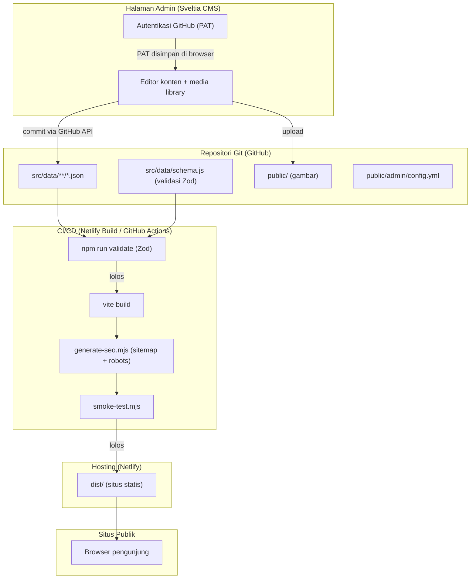
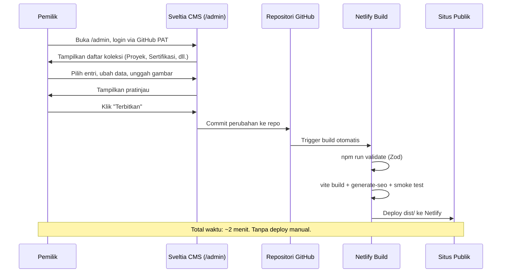
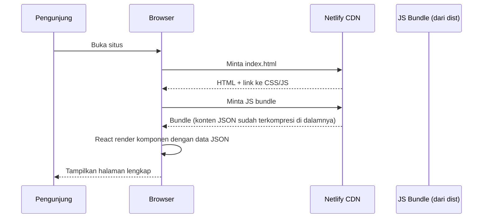
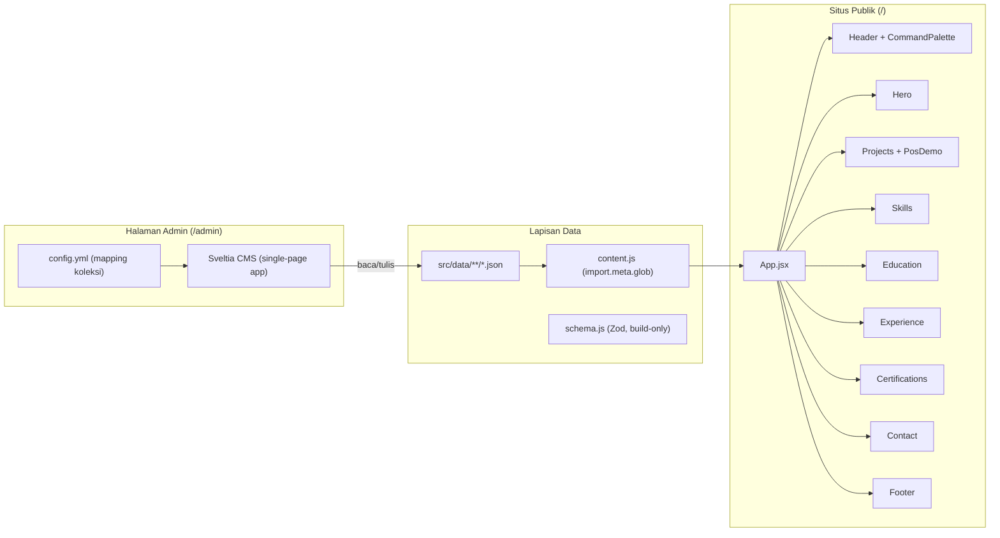
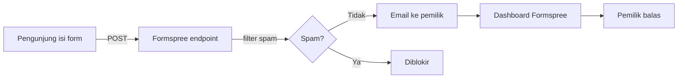
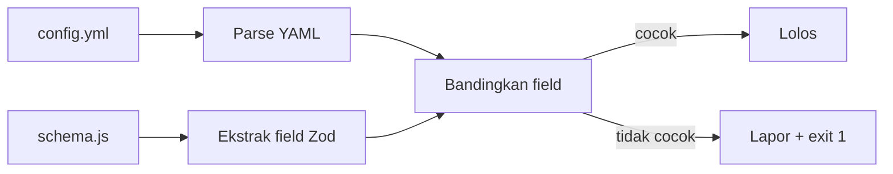

# Arsitektur Sistem: Portofolio Dewa Bintang Nugroho

Dokumen ini menjelaskan arsitektur komponen, alur data, pilihan CMS, dan rencana hosting. Status: perancangan.

---

## 1. Diagram Komponen



## 2. Alur Data

### Alur publikasi konten (pemilik mengedit)



### Alur baca konten (pengunjung)



Catatan: konten ter-embed di JS bundle hasil build. Tidak ada panggilan API saat runtime. Ini membuat situs cepat dan tidak bergantung pada layanan eksternal saat diakses pengunjung.

## 3. Pembagian Frontend



### Lapisan data publik

Situs publik tetap static. Konten diimpor dari file JSON saat build oleh Vite, lalu terkompresi ke bundle JS. Saat runtime, tidak ada panggilan API. Lapisan data terdiri dari:

- `src/data/content.js`: memuat seluruh file JSON lewat `import.meta.glob` (pengganti import per-file) dan merakitnya jadi satu objek.
- `src/data/schema.js`: skema Zod, hanya dipakai saat build (`npm run validate`), tidak masuk bundle.
- `src/data/**/*.json`: file konten per entri, bisa ditambah/edit/hapus lewat CMS.

### Lapisan admin

- `public/admin/index.html`: halaman yang memuat Sveltia CMS dari CDN.
- `public/admin/config.yml`: konfigurasi koleksi, field, dan autentikasi.
- Sveltia CMS berjalan sebagai single-page app terpisah dari situs publik. Buka di `/admin/`.

## 4. Perbandingan Opsi Pengelolaan Konten

### 4.1 Sveltia CMS (Git-based, JSON di repo)

Sveltia CMS adalah penerus modern Decap CMS (dulunya Netlify CMS). Berjalan sebagai single-page app dari CDN, mengedit file di repo Git lewat autentikasi. Sumber: [GitHub Sveltia CMS](https://github.com/sveltia/sveltia-cms), [Jamstack](https://jamstack.org/headless-cms/sveltia-cms/).

### 4.2 Supabase (database + auth + storage)

Supabase menyediakan PostgreSQL, autentikasi, storage, dan REST/GraphQL API. Aplikasi fetch konten dari API saat runtime. Sumber: [Supabase Pricing](https://supabase.com/pricing).

### 4.3 Sanity (headless CMS, free tier)

Sanity menyediakan Sanity Studio (admin UI siap pakai) dan content lake (database terdistribusi dengan CDN). Aplikasi fetch konten lewat GROQ atau API. Sumber: [Sanity Pricing](https://www.sanity.io/pricing).

### 4.4 TinaCMS (Git-based + visual editing)

TinaCMS mengedit konten langsung di tampilan situs (visual editing), menyimpan ke repo Git, dan menyinkronkan via Tina Cloud. Sumber: [TinaCMS](https://tina.io).

### Tabel Perbandingan

| Kriteria | Sveltia CMS | Supabase | Sanity | TinaCMS |
|----------|-------------|----------|--------|---------|
| Biaya | Rp 0 | Rp 0 (free tier) | Rp 0 (free tier) | Rp 0 (free tier, terbatas) |
| Limit free tier | Tidak ada (open source) | 500 MB DB, 1 GB storage, 50k MAU, project pause setelah 1 minggu idle | 500k API request/bln, 10 GB aset, 3 user | 2 user, 5k node, butuh Tina Cloud untuk sync |
| Admin UI | Bawaan, siap pakai | Harus dibangun sendiri | Sanity Studio, siap pakai | Visual editor di situs + dashboard |
| Format konten | JSON/Markdown di repo | Tabel PostgreSQL (API) | Content lake (API + GROQ) | JSON/Markdown di repo + Tina Cloud |
| Runtime dependency | Tidak ada (static) | Ya (fetch API saat load) | Ya (fetch API saat load) | Tidak ada (static, kecuali visual editor) |
| SEO | Bagus (konten di bundle) | Kurang (konten fetch runtime, tidak di HTML) | Kurang (sama, kecuali pakai SSR/ISR) | Bagus (konten di repo) |
| Performa publik | Terbaik (static, tidak ada API call) | Tergantung latensi API + perlu loading state | Tergantung latensi API (CDN Sanity membantu) | Terbaik (static) |
| Build ulang diperlukan | Ya, otomatis via CI | Tidak (instan) | Tidak (instan) | Ya, otomatis via CI |
| Vendor lock-in | Rendah (konten di repo, CMS open source) | Sedang (PostgreSQL portable, tapi API Supabase spesifik) | Tinggi (GROQ + content lake proprietary) | Sedang (format Tina di repo, tapi Tina Cloud proprietary) |
| Kecocokan React + Vite | Sangat cocok (konten JSON diimpor saat build) | Cocok (perlu @supabase/supabase-js, loading state, error handling) | Cocok (perlu @sanity/client atau next.js untuk SSR) | Cocok (perlu @tinacms, lebih cocok dengan Next.js) |
| Kompleksitas setup | Rendah (tambah config.yml + index.html) | Tinggi (desain DB, RLS, auth, admin UI, API client) | Sedang (define schema Sanity, setup Studio, query GROQ) | Sedang (define schema Tina, setup Tina Cloud, integrasi) |
| Upload gambar | Media library bawaan (simpan ke repo) | Supabase Storage | Sanity asset CDN | Media library bawaan |
| Keamanan | Autentikasi via GitHub (PAT atau OAuth). Tidak ada API publik. | RLS wajib. API publik untuk baca konten. | API key. Query publik dengan batasan. | Autentikasi via Tina Cloud. |
| Risiko downtime | Tidak ada (situs static terus jalan walau CMS down) | Project pause 1 minggu idle = situs blank | Tidak ada (CDN, tapi API tetap dibutuhkan saat load) | Tidak ada (situs static terus jalan) |
| Bahasa Indonesia UI | Ya (25+ bahasa termasuk Indonesia) | Tidak (admin buatan sendiri) | Sebagian (customizable) | Tidak |
| Mobile support | Ya (Sveltia perbaikan utama vs Decap) | Tergantung implementasi | Ya | Ya |

## 5. Rekomendasi: Sveltia CMS

### Alasan

1. **Memanfaatkan struktur yang sudah ada.** Konten sudah berupa JSON dan tervalidasi Zod. Sveltia CMS mengedit file JSON di repo, jadi skema dan proses validasi tidak perlu dirombak. Perubahan pada `schema.js` minimal.

2. **Situs tetap static.** Konten ter-embed di JS bundle saat build. Tidak ada API runtime. Hasil: paling cepat untuk pengunjung, SEO terbaik, dan tidak ada risiko "situs blank" jika layanan eksternal down atau project pause.

3. **Biaya nol tanpa batas praktis.** Sveltia CMS open source dan gratis. Hosting gratis di Netlify atau Vercel. Autentikasi via GitHub PAT tidak butuh layanan tambahan berbayar. Tidak ada limit API request, tidak ada limit dokumen, tidak ada risk project pause.

4. **Admin UI siap pakai.** Login, daftar koleksi, form tambah/edit, upload gambar, pratinjau, dan hapus dengan konfirmasi sudah disediakan. Tidak perlu membangun antarmuka admin dari nol.

5. **Vendor lock-in rendah.** Konten ada di repo Git. Jika Sveltia CMS bermasalah, bisa ganti ke Decap CMS (format config.yml kompatibel) tanpa migrasi data. Jika hosting pindah, repo tetap utuh.

6. **Bahasa Indonesia.** Sveltia CMS mendukung 25+ bahasa termasuk Indonesia. Pemilik yang tidak fasih Inggris tetap nyaman memakainya.

7. **Publish otomatis tanpa deploy manual.** CMS commit ke repo, CI auto-build dan auto-deploy. Pemilik hanya klik "Terbitkan" di CMS.

### Tradeoff yang diterima

Perubahan konten butuh sekitar 2 menit untuk tampil di situs (waktu build CI). Untuk portofolio yang update-nya tidak real-time, ini bisa diterima. Jika kelak butuh instan, struktur file JSON bisa dipertahankan dan ditambahkan Supabase sebagai cache runtime tanpa mengubah sumber utama.

## 6. Desain Halaman Admin

Sveltia CMS menyediakan halaman admin sebagai single-page app. Berikut pemetaan kebutuhan admin:

### 6.1 Login

- URL: `/admin/`
- Autentikasi: GitHub Personal Access Token (PAT). Pemilik klik "Sign In with Token" di layar login Sveltia CMS, lalu tempel token dari GitHub.
- Token disimpan di local storage browser. Sesi tetap aktif sampai pemilik keluar manual atau token kedaluwarsa.
- Setelah login: redirect ke dashboard daftar koleksi.
- Detail lengkap setup token, scope minimum, dan risiko: lihat bagian 11.

### 6.2 Daftar Koleksi (dashboard)

Tampilan grid atau list yang menampilkan semua koleksi konten:

| Koleksi | Sumber file | Jumlah entri saat ini |
|---------|-------------|----------------------|
| Profil | `src/data/site.json` | 1 (single file) |
| Proyek | `src/data/projects/*.json` | 3 |
| Keahlian | `src/data/skills/*.json` | 5 grup |
| Pengalaman | `src/data/experience/*.json` | 1 |
| Pendidikan | `src/data/education/*.json` | 1 |
| Sertifikasi | `src/data/certifications/*.json` | 2 |

Klik koleksi melihat daftar entri. Klik entri untuk edit. Tombol "Tambah baru" untuk buat entri.

### 6.3 Form Tambah/Edit

Setiap koleksi punya form dengan field yang dipetakan dari skema Zod. Contoh untuk Proyek:

| Field | Tipe widget | Validasi | Wajib |
|-------|-------------|---------|-------|
| id | string | huruf kecil, angka, tanda hubung | Ya |
| title | string | tidak kosong | Ya |
| context | text (textarea) | tidak kosong | Ya |
| role | string | boleh kosong | Tidak |
| tech | list (repeatable string) | minimal 1 jika diisi | Tidak |
| techUnverified | list (repeatable object: name + verified) | opsional | Tidak |
| results | list (repeatable string) | boleh kosong | Tidak |
| repo | string (URL) | URL valid atau kosong | Tidak |
| demo | string (URL) | URL valid atau kosong | Tidak |
| screenshot | image (path) | path dari public/ atau kosong | Tidak |
| screenshotAlt | string | boleh kosong | Tidak |
| interactiveDemo | select (pos / kosong) | opsional | Tidak |

### 6.4 Upload Gambar

Sveltia CMS punya media library bawaan. Saat pemilik upload gambar (screenshot proyek atau sertifikat), CMS menyimpan file ke folder `public/` di repo. Path gambar otomatis terisi di field yang relevan.

Folder media: `public/` (sudah ada, tidak perlu ubah).

**Batas ukuran dan format:**

| Jenis gambar | Resolusi maksimum | Ukuran file maksimum | Format |
|--------------|-------------------|----------------------|--------|
| Screenshot proyek | 1200x800 px | 500 KB | WebP atau AVIF |
| Sertifikat | 1000x1400 px | 300 KB | WebP |
| Foto profil (Hero) | 224x224 px (2x untuk retina) | 50 KB | WebP atau JPEG |
| OG image (social) | 1200x630 px | 200 KB | JPEG atau PNG |
| Favicon | 48x48 px | 5 KB | SVG (sederhana) |

**Strategi optimasi otomatis:**

1. **Optimasi saat build dengan `sharp`**: tambah script `scripts/optimize-images.mjs` yang berjalan sebagai langkah `postbuild`. Script ini memproses gambar di `dist/` (hasil copy dari `public/` oleh Vite) lalu mengompresi dan mengubah ukuran sesuai batas di atas. Hasil: repo menyimpan gambar asli, tetapi yang ter-deploy sudah teroptimasi. Pakai `sharp` (library yang sama dipakai calibreapp/image-actions), jadi kualitas sama. Tidak perlu modifikasi file repo atau membuat PR tambahan.
2. **Validasi saat build**: tambah pengecekan di `validate-content.mjs` atau script terpisah yang memeriksa ukuran file dan dimensi gambar di `public/`. Jika gambar melebihi batas, build memberi peringatan (tidak gagal, agar tidak memblokir alur kerja).
3. **Saran di CMS**: tambah `hint` pada field image di `config.yml` yang menampilkan resolusi dan ukuran yang disarankan.

Catatan: calibreapp/image-actions tidak dipakai karena tool tersebut hanya auto-commit gambar teroptimasi pada Pull Request. Saat CMS commit langsung ke main (Simple Workflow), tool ini tidak bisa commit kembali ke branch yang sama. Optimasi saat build menghindari masalah ini dan lebih sederhana untuk satu pemilik.

**Catatan keamanan**: gambar yang diupload ke repo publik bisa diakses siapa saja. Jangan unggah dokumen sensitif. Sertifikat dan screenshot proyek sudah dirancang untuk tampil publik, jadi aman.

### 6.5 Pratinjau

Sveltia CMS punya panel pratinjau di sisi kanan editor. Saat field diisi, pratinjau memperlihatkan hasil secara langsung. Untuk pratinjau yang akurat, bisa daftarkan template React per koleksi (opsional, bisa disempurnakan bertahap).

### 6.6 Hapus dengan Konfirmasi

Saat pemilik klik "Hapus" pada entri, Sveltia CMS menampilkan dialog konfirmasi. Setelah konfirmasi, CMS commit penghapusan ke repo. Build otomatis berjalan, dan entri hilang dari situs.

## 7. Alur Publikasi

1. Pemilik buka `/admin/`, login dengan GitHub PAT (lihat bagian 11 untuk detail).
2. Pilih koleksi (mis. Proyek), pilih entri atau klik "Tambah baru".
3. Isi form, unggah gambar jika perlu, lihat pratinjau.
4. Klik "Terbitkan" (publish) atau "Simpan draf" (draft, jika editorial workflow diaktifkan).
5. Sveltia CMS commit perubahan ke repo GitHub.
6. Hosting (Netlify atau Vercel) mendeteksi push, menjalankan `npm run build` (termasuk `npm run validate`).
7. Jika validasi Zod gagal, build gagal. Perubahan tidak ter-deploy. Pemilik dapat notifikasi.
8. Jika lolos, build selesai dan dist/ ter-deploy. Perubahan tampil di situs dalam sekitar 2 menit.

## 8. Migrasi Data

### 8.1 Status saat ini

Konten tersimpan sebagai array JSON dalam satu file per entitas:

```
src/data/projects.json       -> [{ id: "pos", ... }, { id: "rasa", ... }, ...]
src/data/certifications.json -> [{ title: "...", ... }, ...]
src/data/skills.json         -> [{ group: "Frontend", ... }, ...]
src/data/experience.json     -> [{ period: "...", ... }, ...]
src/data/education.json      -> [{ period: "...", ... }, ...]
src/data/site.json           -> { name: "...", ... }  (sudah single object)
src/data/ui.json             -> { skipLink: "...", ... }  (single object, tidak dikelola CMS)
src/data/demo.json           -> { currency: "...", ... }  (single object, tidak dikelola CMS)
src/data/placeholders.json   -> [...]  (tidak dikelola CMS)
```

### 8.2 Struktur setelah migrasi

Setiap entri array dipecah jadi file sendiri:

```
src/data/site.json               (tetap, single object, dikelola CMS sebagai file collection)
src/data/projects/pos.json       (satu proyek per file)
src/data/projects/rasa.json
src/data/projects/dialogflow.json
src/data/skills/frontend.json    (satu grup keahlian per file)
src/data/skills/backend.json
src/data/skills/integrasi.json
src/data/skills/ai-nlp.json
src/data/skills/infra.json
src/data/experience/dimsum-gembul.json
src/data/education/sahid.json
src/data/certifications/usahid.json
src/data/certifications/hacktiv8.json
src/data/ui.json                 (tetap, tidak dikelola CMS)
src/data/demo.json               (tetap, tidak dikelola CMS)
src/data/placeholders.json       (tetap, tidak dikelola CMS)
```

### 8.3 Perubahan pada kode

**`src/data/content.js`** berubah dari import per-file menjadi `import.meta.glob`:

```javascript
// Sebelum
import projects from './projects.json'

// Sesudah
const projectModules = import.meta.glob('./projects/*.json', { eager: true })
const projects = Object.values(projectModules).map((m) => m.default)
```

Polanya sama untuk skills, experience, education, dan certifications. `site.json` tetap import biasa (single object).

### 8.4 Perubahan pada skema

**`src/data/schema.js`** tidak perlu mengubah definisi skema per entitas (projectSchema, dll. tetap). Yang berubah:

- `contentSchema` tidak lagi menerima array untuk projects, skills, education, experience, certifications. Sebagai gantinya, `validate-content.mjs` memvalidasi setiap file individual.
- `validate-content.mjs` baca folder lewat `fs.readdirSync`, validasi tiap file dengan skema entitas.

Contoh perubahan `validate-content.mjs`:

```javascript
// Sebelum: validasi array
const okProjects = report('projects', z.array(projectSchema).safeParse(readJson('projects.json')))

// Sesudah: validasi per file
const projectFiles = fs.readdirSync(path.join(dataDir, 'projects'))
for (const file of projectFiles) {
  const ok = report(`projects/${file}`, projectSchema.safeParse(readJson(`projects/${file}`)))
  if (!ok) hasError = true
}
```

### 8.5 Konfigurasi Sveltia CMS

File `public/admin/config.yml` mendefinisikan koleksi dan field. Contoh untuk Proyek:

```yaml
backend:
  name: github
  repo: dewanugroho/portofolio
  branch: main

media_folder: "public"
public_folder: "/"

collections:
  - name: "projects"
    label: "Proyek"
    folder: "src/data/projects"
    create: true
    delete: true
    format: "json"
    extension: "json"
    slug: "{{id}}"
    identifier_field: "title"
    fields:
      - { label: "ID", name: "id", widget: "string", pattern: ["^[a-z0-9-]+$", "huruf kecil, angka, tanda hubung"] }
      - { label: "Judul", name: "title", widget: "string" }
      - { label: "Konteks", name: "context", widget: "text" }
      - { label: "Peran", name: "role", widget: "string", required: false }
      - { label: "Teknologi", name: "tech", widget: "list", required: false }
      - { label: "Repo", name: "repo", widget: "string", required: false }
      - { label: "Demo URL", name: "demo", widget: "string", required: false }
      - { label: "Screenshot", name: "screenshot", widget: "image", required: false }
      - { label: "Alt Screenshot", name: "screenshotAlt", widget: "string", required: false }
      - { label: "Demo Interaktif", name: "interactiveDemo", widget: "select", options: ["", "pos"], required: false }
      - label: "Hasil"
        name: "results"
        widget: "list"
        required: false
        field: { label: "Item", name: "item", widget: "string" }
      # ... field lain sesuai skema
```

Koleksi lain (Sertifikasi, Keahlian, Pengalaman, Pendidikan, Profil) dikonfigurasi dengan pola yang sama.

### 8.6 File admin

`public/admin/index.html`:

```html
<!doctype html>
<html>
  <head>
    <meta charset="utf-8" />
    <meta name="viewport" content="width=device-width, initial-scale=1.0" />
    <title>Admin Portofolio</title>
  </head>
  <body>
    <script src="https://unpkg.com/@sveltia/cms/dist/sveltia-cms.js"></script>
  </body>
</html>
```

Catatan: tidak perlu widget tambahan. Sveltia CMS menangani login GitHub PAT bawaan.

## 9. Hosting

### Pilihan: Netlify atau Vercel (keduanya bekerja sama)

Karena autentikasi CMS pakai GitHub PAT (bukan layanan hosting-specific), situs bisa di-deploy ke Netlify maupun Vercel tanpa perubahan konfigurasi CMS.

**Netlify:**
- `netlify.toml` sudah ada dan terkonfigurasi.
- Build otomatis dari GitHub repo.
- HTTPS dan domain gratis (`*.netlify.app`).
- SPA redirect sudah terkonfigurasi di `netlify.toml` dan `public/_redirects`.

**Vercel:**
- Buat project, hubungkan repo, set build command `npm run build` dan output `dist`.
- HTTPS dan domain gratis (`*.vercel.app`).
- Tambah `vercel.json` untuk SPA redirect jika diperlukan.

**Penyiapan environment variable (sama untuk keduanya):**
1. Set `VITE_SITE_URL` ke domain final di environment variables panel.
2. Pastikan build command adalah `npm run build`.
3. Pastikan output directory adalah `dist`.

### Autentikasi tidak bergantung hosting

Login CMS pakai GitHub PAT disimpan di local storage browser pemilik. Tidak ada layanan autentikasi yang perlu di-setup di Netlify atau Vercel. Pemilik cukup buka `/admin/` di domain mana pun situs di-deploy.

## 10. Ringkasan Perubahan Minimum pada Skema

| Komponen | Perubahan | Dampak |
|----------|-----------|--------|
| `schema.js` | Tidak ada perubahan pada definisi skema entitas (projectSchema, dll). | Skema per entitas tetap berfungsi. |
| `schema.js` | `contentSchema` tidak lagi membungkus proyek/skill/dll sebagai array. Sebagai gantinya, validasi per file. | `validate-content.mjs` perlu disesuaikan. |
| `validate-content.mjs` | Baca folder, validasi tiap file individual. | Logika berubah tapi output tetap sama. |
| `content.js` | Ganti import per-file dengan `import.meta.glob` untuk koleksi array. | Struktur data output tetap sama. |
| `content.js` | `site.json` tetap import biasa. | Tidak berubah. |
| `ui.json`, `demo.json`, `placeholders.json` | Tidak berubah, tidak dikelola CMS. | Tidak ada dampak. |

## 11. Autentikasi Admin: GitHub PAT

### 11.1 Mengapa PAT, bukan Netlify Identity atau Git Gateway

Netlify Identity dan Git Gateway resmi deprecated oleh Netlify. Dokumentasi Netlify menyatakan: "Git Gateway is deprecated. New Git Gateway configurations are not recommended." Demikian juga Netlify Identity service dan GoTrue API. Walaupun masih berfungsi untuk site yang sudah aktif, bug tidak lagi diperbaiki dan konfigurasi baru tidak disarankan.

Sveltia CMS mendukung login langsung dengan GitHub Personal Access Token (PAT). Metode ini tidak bergantung pada layanan hosting apa pun, jadi bekerja sama baik di Netlify maupun Vercel. Sumber: [dokumentasi Sveltia CMS GitHub Backend](https://sveltiacms.app/en/docs/backends/github).

### 11.2 Langkah setup

1. **Di `config.yml`**, pastikan backend diset ke GitHub:
   ```yaml
   backend:
     name: github
     repo: dewanugroho/portofolio
     branch: main
   ```

2. **Buat token di GitHub**: buka [github.com/settings/personal-access-tokens/new](https://github.com/settings/personal-access-tokens/new) (fine-grained token). Pilih repo `portofolio`, set permission:
   - **Contents**: Read and write (untuk baca dan commit entri serta aset)
   - **Metadata**: Read (otomatis ditambahkan GitHub)
   - Set expiration: 90 hari (lalu buat ulang). Jangan pilih "No expiration".
   - Catatan: scope Pull requests tidak perlu untuk proyek ini. Proyek ini pakai Simple Workflow (commit langsung ke main), bukan Editorial Workflow (branch + PR per entri).

3. **Login di CMS**: buka `namadomain.netlify.app/admin/` (atau domain Vercel). Klik "Sign In with Token". Tempel token dari GitHub.

4. **Selesai**. Token disimpan di local storage browser. Sesi tetap aktif sampai pemilik klik "Sign Out" atau token kedaluwarsa.

### 11.3 Scope minimum token

| Permission | Level | Diperlukan untuk | Wajib? |
|-----------|-------|------------------|--------|
| Contents | Read and write | Baca file konten, commit perubahan, upload gambar | Ya |
| Metadata | Read | Akses info repo dasar | Otomatis (GitHub) |

Scope Pull requests tidak diperlukan untuk proyek ini karena CMS pakai Simple Workflow (commit langsung ke main). Jika kelak beralih ke Editorial Workflow, tambahkan Pull requests: Read and write.

Untuk Classic Token (jika fine-grained tidak tersedia), scope minimum adalah `repo` (mencakup Contents dan Metadata). Fine-grained lebih disarankan karena scope lebih sempit.

### 11.4 Risiko penyimpanan token

Token disimpan di **local storage browser** pemilik. Risiko:

| Risiko | Dampak | Mitigasi |
|--------|--------|----------|
| Orang lain pakai komputer pemilik yang tidak terkunci | Bisa login CMS dan edit konten | Kunci layar saat tidak dipakai. Klik "Sign Out" setelah selesai edit. |
| Token terlihat di DevTools (Application > Local Storage) | Siapa pun yang buka DevTools bisa salin token | Jangan share sesi browser. Gunakan browser terpisah untuk admin. |
| Token lama tidak di-revoke | Token kedaluwarsa masih aktif jika expiration panjang | Set expiration 90 hari. Hapus token lama di GitHub settings setelah kedaluwarsa. |
| XSS di situs publik mencuri token | Token CMS ter-exfiltrasi | Sveltia CMS berjalan di `/admin/` yang terpisah dari situs publik. Tidak ada script pihak ketiga di halaman admin. CSP header (Fase 0) menambah proteksi. |

### 11.5 Opsi cadangan: Sveltia CMS Authenticator di Cloudflare Workers

Jika kelak diperlukan multi-user atau login yang lebih aman (tidak menyimpan PAT di browser), gunakan [Sveltia CMS Authenticator](https://github.com/sveltia/sveltia-cms-auth): skrip Cloudflare Workers yang menangani OAuth authorization code flow dengan GitHub.

**Kapan beralih ke opsi ini:**
- Butuh lebih dari satu editor (tim).
- Ingin login tanpa menyimpan PAT di browser (lebih aman).
- Ingin token yang otomatis di-refresh (PAT tidak auto-refresh).

**Langkah beralih:**
1. Deploy Sveltia CMS Authenticator di Cloudflare Workers (gratis, lihat [repo](https://github.com/sveltia/sveltia-cms-auth) untuk instruksi).
2. Daftarkan GitHub OAuth App, set callback URL ke URL Cloudflare Worker.
3. Tambah `base_url: https://auth-worker-anda.workers.dev` di `config.yml`.
4. Hapus PAT dari local storage (Sign Out, lalu login ulang dengan OAuth).

Konfigurasi `config.yml` setelah beralih:

```yaml
backend:
  name: github
  repo: dewanugroho/portofolio
  branch: main
  base_url: https://auth-worker-anda.workers.dev
```

Opsi ini tetap bekerja di Netlify maupun Vercel karena authenticator berjalan terpisah di Cloudflare Workers.

## 12. Formulir Kontak

### 12.1 Pilihan: Formspree

**Formspree** dipilih sebagai solusi form kontak karena:

- **Tidak bergantung pada hosting**. Bekerja di Netlify, Vercel, Cloudflare Pages, atau hosting statis apa pun. Cukup tambah `action` ke URL endpoint Formspree di form HTML.
- **Gratis 50 submission per bulan**. Cukup untuk portofolio yang menerima pesan sesekali.
- **Proteksi spam bawaan**: Formspree punya filter spam otomatis (Akismet) dan opsi reCAPTCHA invisible. Tidak perlu setup tambahan untuk anti-spam dasar.
- **Notifikasi email**: pesan langsung dikirim ke email pemilik. Tidak perlu cek dashboard manual.
- **Tidak butuh backend sendiri**. Tidak ada server untuk dirawat, tidak ada database, tidak ada biaya.

### 12.2 Cara kerja



### 12.3 Setup

1. Daftar akun gratis di [formspree.io](https://formspree.io).
2. Buat form baru, dapatkan endpoint URL (mis. `https://formspree.io/f/xxxxxxx`).
3. Tambah form di `Contact.jsx` dengan `action` ke endpoint Formspree.
4. Tambah honeypot field tersembunyi sebagai lapisan anti-spam tambahan.
5. Set `VITE_FORMSPREE_ID` di `.env` untuk endpoint ID (agar tidak hardcoded).

Contoh form:

```html
<form action="https://formspree.io/f/{VITE_FORMSPREE_ID}" method="POST">
  <!-- Honeypot: field ini harus kosong. Bot otomatis mengisi semua field. -->
  <input type="text" name="_gotcha" style="display:none" tabindex="-1" autocomplete="off" />
  <input type="text" name="name" required placeholder="Nama" />
  <input type="email" name="email" required placeholder="Email" />
  <textarea name="message" required placeholder="Pesan"></textarea>
  <button type="submit">Kirim</button>
</form>
```

### 12.4 Proteksi spam (berlapis)

| Lapisan | Cara | Aktif otomatis? |
|--------|------|-----------------|
| 1. Akismet filter | Formspree cek setiap submission | Ya |
| 2. Honeypot field | Field tersembunyi yang bot isi otomatis | Tambah manual di form |
| 3. Rate limiting | Formspree batasi submission per IP | Ya |
| 4. Opsi reCAPTCHA | Invisible reCAPTCHA di Formspree settings | Aktifkan di dashboard |

## 13. Validasi dan Konsistensi Skema CMS

### 13.1 Validasi Zod saat build (sudah ada, pertahankan)

Validasi Zod dijalankan oleh `npm run validate` yang berjalan sebagai `prebuild` (sebelum `vite build`). Jika data tidak valid, build gagal dan perubahan tidak ter-deploy. Ini sudah berfungsi dan tidak perlu diubah strukturnya.

**Yang perlu dipastikan setelah migrasi ke file per entri:**

- `validate-content.mjs` memvalidasi setiap file JSON individual terhadap skema entitas yang sesuai (lihat bagian 8.4).
- Jika satu file tidak valid (mis. field wajib kosong, id format salah), `validate-content.mjs` melaporkan file dan masalahnya, lalu `process.exit(1)`. Build berhenti.
- CI menjalankan `npm run validate` dan `npm run build` secara berurutan. Keduanya harus lulus.

### 13.2 Tes konsistensi config CMS dengan skema Zod

Risiko: field di `config.yml` bisa drift dari skema Zod. Misalnya, skema Zod menambah field baru `featured: boolean`, tapi lupa menambah field tersebut di `config.yml`. Pemilik tidak bisa mengisi field itu lewat CMS, dan field tetap kosong. Atau sebaliknya: field di config CMS tidak ada di skema Zod, jadi data yang dimasukkan tidak tervalidasi.

**Solusi**: script `scripts/validate-cms-config.mjs` yang membandingkan field di `config.yml` dengan definisi skema Zod.

**Cara kerja:**

1. Parse `public/admin/config.yml` (pakai library YAML parser seperti `yaml`).
2. Untuk setiap koleksi, ekstrak daftar field dari definisi `fields`.
3. Bandingkan dengan daftar field dari skema Zod entitas yang sesuai di `schema.js`:
   - Field wajib di Zod harus `required: true` (atau tidak ada `required: false`) di config.
   - Field opsional di Zod harus `required: false` di config.
   - Field yang ada di config tapi tidak di skema Zod: peringatan.
   - Field yang ada di skema Zod tapi tidak di config: peringatan.
4. Jika ada ketidakcocokan, script melaporkan dan `process.exit(1)`.

**Integrasi CI**: tambah `npm run validate-cms-config` sebagai langkah terpisah di CI, sebelum `npm run build`.

**Estimasi implementasi**: 2-4 jam (lihat TASKS.md tugas 2.12).


