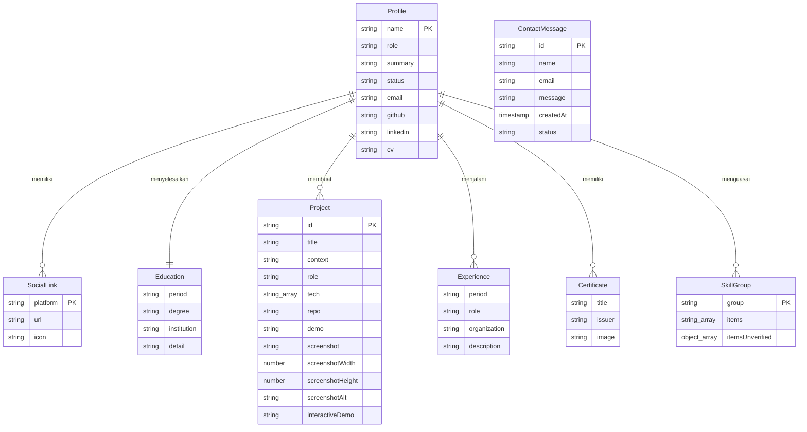
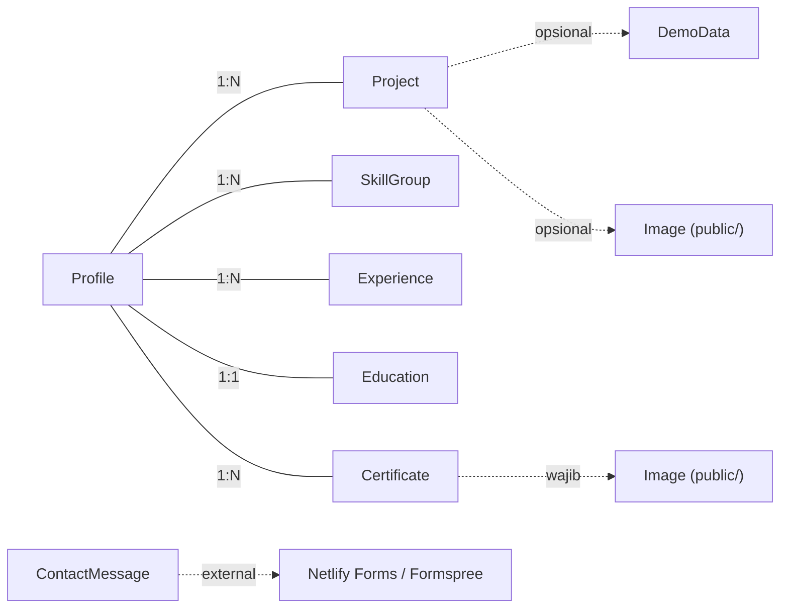

# ERD: Model Data Konten Portofolio

Dokumen ini menjelaskan entitas konten, atribut, tipe, relasi, dan contoh data. Status: perancangan. Entitas dipetakan dari file JSON yang sudah ada di `src/data/`.

---

## 1. Diagram ERD



## 2. Detail Entitas

### 2.1 Profile

Profil pemilik portofolio. Sumber: `src/data/site.json`. Satu entitas (singleton).

| Atribut | Tipe | Wajib | Validasi | Contoh |
|---------|------|-------|---------|--------|
| name | string | Ya | tidak kosong | "Dewa Bintang Nugroho" |
| role | string | Ya | tidak kosong | "Fullstack Developer, Lulusan Informatika" |
| summary | string | Ya | tidak kosong | "Saya tulis aplikasi pakai React dan FastAPI..." |
| status | string | Tidak | boleh kosong | "Terbuka untuk peluang kerja dan proyek freelance" |
| email | string | Ya | tidak kosong | "dewanugroho004@gmail.com" |
| github | string (URL) | Tidak | URL valid atau kosong | "https://github.com/dewanugroho" |
| linkedin | string (URL) | Tidak | URL valid atau kosong | "" (belum diisi) |
| cv | string (path) | Tidak | path atau kosong | "" (belum diisi) |

Catatan: SocialLink (GitHub, LinkedIn) saat ini tertanam di Profile sebagai atribut URL, bukan entitas terpisah. Jika kelak perlu lebih dari 2 link sosial, bisa dipisah jadi entitas sendiri. Untuk sekarang, cukup sebagai atribut Profile.

### 2.2 Project

Proyek atau karya. Sumber: `src/data/projects/*.json` (satu file per proyek). Dikelola via CMS.

| Atribut | Tipe | Wajib | Validasi | Contoh |
|---------|------|-------|---------|--------|
| id | string | Ya | regex `^[a-z0-9-]+$` | "pos" |
| title | string | Ya | tidak kosong | "Sistem Kasir dan Analitik Keuangan (POS)" |
| context | string | Ya | tidak kosong | "Sistem kasir untuk usaha kuliner..." |
| role | string | Tidak | boleh kosong | "Full-stack developer sekaligus pemilik usaha" |
| tech | string[] | Tidak | array string | ["React", "Vite", "Tailwind CSS", "FastAPI"] |
| techUnverified | object[] | Tidak | array {name, verified} | [{name: "Nginx", verified: false}] |
| results | string[] | Tidak | array string | ["Login pakai JWT dan pembayaran QRIS..."] |
| repo | string (URL) | Tidak | URL valid atau kosong | "https://github.com/dewanugroho/dimsum-pos" |
| demo | string (URL) | Tidak | URL valid atau kosong | "" |
| screenshot | string (path) | Tidak | path dari public/ | "/projects/rasa-confusion-matrix.webp" |
| screenshotWidth | number | Tidak | positive | 1110 |
| screenshotHeight | number | Tidak | positive | 1200 |
| screenshotAlt | string | Tidak | boleh kosong | "Confusion matrix evaluasi intent Rasa..." |
| interactiveDemo | enum | Tidak | "pos" atau tidak ada | "pos" |

Catatan: `techUnverified` menyimpan klaim teknologi yang belum dikonfirmasi pemilik. Field dengan `verified: false` tidak tampil di situs publik, hanya tampil setelah `verified` diubah ke `true`.

### 2.3 SkillGroup

Grup keahlian. Sumber: `src/data/skills/*.json` (satu file per grup). Dikelola via CMS.

| Atribut | Tipe | Wajib | Validasi | Contoh |
|---------|------|-------|---------|--------|
| group | string | Ya | tidak kosong | "Frontend" |
| items | string[] | Tidak | array string | ["React", "Tailwind CSS", "Vite"] |
| itemsUnverified | object[] | Tidak | array {name, verified} | [{name: "Nginx", verified: false}] |

### 2.4 Education

Riwayat pendidikan. Sumber: `src/data/education/*.json` (satu file per entri). Dikelola via CMS.

| Atribut | Tipe | Wajib | Validasi | Contoh |
|---------|------|-------|---------|--------|
| period | string | Ya | tidak kosong | "2022 - 2026" |
| degree | string | Ya | tidak kosong | "S1 Informatika" |
| institution | string | Ya | tidak kosong | "Universitas Sahid Surakarta" |
| detail | string | Tidak | boleh kosong | "Lulus September 2026 dengan IPK 3,66/4,00, cum laude." |

### 2.5 Experience

Riwayat pengalaman. Sumber: `src/data/experience/*.json` (satu file per entri). Dikelola via CMS.

| Atribut | Tipe | Wajib | Validasi | Contoh |
|---------|------|-------|---------|--------|
| period | string | Ya | tidak kosong | "2025 - Sekarang" |
| role | string | Ya | tidak kosong | "Pemilik & Pengembang Sistem" |
| organization | string | Ya | tidak kosong | "Dimsum Gembul" |
| description | string | Tidak | boleh kosong | "Saya bangun sistem kasir..." |

### 2.6 Certificate

Sertifikasi. Sumber: `src/data/certifications/*.json` (satu file per sertifikat). Dikelola via CMS.

| Atribut | Tipe | Wajib | Validasi | Contoh |
|---------|------|-------|---------|--------|
| title | string | Ya | tidak kosong | "IBM SkillsBuild University Education: AI Agent for Programming" |
| issuer | string | Ya | tidak kosong | "Hacktiv8 Indonesia" |
| image | string (path) | Ya | regex `^/` (path absolut dari public/) | "/sertifikat-hacktiv8.webp" |

### 2.7 ContactMessage

Pesan dari pengunjung via form kontak. Entitas ini tidak disimpan di repo Git (tidak bisa ditulis dari client). Disimpan via layanan eksternal.

**Penyimpanan**: Netlify Forms (gratis, submissions tersimpan di dashboard Netlify dan kirim email notifikasi) atau Formspree (gratis 50 submission/bulan).

| Atribut | Tipe | Wajib | Validasi | Contoh |
|---------|------|-------|---------|--------|
| id | string (auto) | Ya | auto-generate | "msg_001" |
| name | string | Ya | tidak kosong | "Andi Pratama" |
| email | string (email) | Ya | format email | "andi@email.com" |
| message | string | Ya | minimal 10 karakter | "Halo, saya tertarik dengan jasa..." |
| createdAt | timestamp | Ya | auto | 2026-11-02T10:00:00Z |
| status | enum | Ya | "new" / "read" / "replied" | "new" |

Catatan: jika memakai Netlify Forms, atribut ini dikonfigurasi di form HTML, bukan di JSON. Pemilik membaca pesan di dashboard Netlify. Jika memakai Formspree, pesan dikirim ke email pemilik. Tidak perlu database.

### 2.8 Entitas Pendukung (tidak dikelola CMS)

| Entitas | Sumber | Dikelola CMS? | Keterangan |
|---------|--------|---------------|-----------|
| UIData | `src/data/ui.json` | Tidak | Teks antarmuka (label tombol, placeholder, dll). Developer-facing, bukan konten. |
| DemoData | `src/data/demo.json` | Tidak | Data dummy untuk demo POS. Bukan klaim, memang contoh. |
| Placeholder | `src/data/placeholders.json` | Tidak | Daftar TODO konten yang belum diisi. Hanya untuk pemilik, tidak tampil di publik. |

## 3. Relasi



Catatan: relasi Profile ke entitas lain bersifat konseptual. Di implementasi, Profile tidak punya foreign key ke entitas lain. Semua entri Proyek, Sertifikat, dll. diasosiasikan ke pemilik tunggal (karena ini portofolio pribadi satu orang). Tidak ada tabel junction atau relasi many-to-many.

## 4. Contoh Data Lengkap

### Profile (site.json)

```json
{
  "name": "Dewa Bintang Nugroho",
  "role": "Fullstack Developer, Lulusan Informatika",
  "summary": "Saya tulis aplikasi pakai React dan FastAPI. Sistem kasir untuk usaha kuliner saya sendiri sudah dipakai sehari-hari.",
  "status": "Terbuka untuk peluang kerja dan proyek freelance",
  "email": "dewanugroho004@gmail.com",
  "github": "https://github.com/dewanugroho",
  "linkedin": "https://linkedin.com/in/dewanugroho",
  "cv": "/cv-dewa-bintang.pdf"
}
```

### Project (projects/pos.json)

```json
{
  "id": "pos",
  "interactiveDemo": "pos",
  "title": "Sistem Kasir dan Analitik Keuangan (POS)",
  "context": "Sistem kasir untuk usaha kuliner yang saya kelola sendiri. Aplikasinya mencatat transaksi dan menampilkan tren penjualan.",
  "role": "Full-stack developer sekaligus pemilik usaha",
  "tech": ["React", "Vite", "Tailwind CSS", "FastAPI", "SQLAlchemy", "SQLite", "PyJWT", "Midtrans Snap (QRIS)", "Recharts"],
  "techUnverified": [
    { "name": "Nginx", "verified": false },
    { "name": "Linux VPS", "verified": false }
  ],
  "results": [
    "Login pakai JWT dan pembayaran QRIS lewat Midtrans Snap",
    "Dasbor menampilkan tren penjualan 30 hari terakhir",
    "Dipakai untuk operasional usaha kuliner Dimsum Gembul"
  ],
  "repo": "https://github.com/dewanugroho/dimsum-pos",
  "demo": "",
  "screenshot": "/projects/pos-screenshot.webp",
  "screenshotWidth": 1200,
  "screenshotHeight": 800,
  "screenshotAlt": "Tampilan aplikasi POS dan dasbor analitik keuangannya"
}
```

### Certificate (certifications/hacktiv8.json)

```json
{
  "title": "IBM SkillsBuild University Education: AI Agent for Programming",
  "issuer": "Hacktiv8 Indonesia",
  "image": "/sertifikat-hacktiv8.webp"
}
```

### SkillGroup (skills/frontend.json)

```json
{
  "group": "Frontend",
  "items": ["React", "Tailwind CSS", "Vite"],
  "itemsUnverified": []
}
```

### Education (education/sahid.json)

```json
{
  "period": "2022 - 2026",
  "degree": "S1 Informatika",
  "institution": "Universitas Sahid Surakarta",
  "detail": "Lulus September 2026 dengan IPK 3,66/4,00, cum laude."
}
```

### Experience (experience/dimsum-gembul.json)

```json
{
  "period": "2025 - Sekarang",
  "role": "Pemilik & Pengembang Sistem",
  "organization": "Dimsum Gembul",
  "description": "Saya bangun sistem kasir untuk usaha kuliner ini. Aplikasinya mencatat transaksi dan menerima pembayaran QRIS."
}
```

### ContactMessage (contoh, via Netlify Forms)

```json
{
  "id": "msg_20261102_001",
  "name": "Andi Pratama",
  "email": "andi@startup.id",
  "message": "Halo, saya tertarik dengan sistem POS yang Anda buat. Bisakah kita diskusi lebih lanjut?",
  "createdAt": "2026-11-02T10:00:00Z",
  "status": "new"
}
```

## 5. Catatan Skema

- Semua entitas sudah tervalidasi oleh skema Zod di `src/data/schema.js`. Setelah migrasi ke file per entri, skema per entitas tetap sama. Yang berubah: `validate-content.mjs` memvalidasi per file, bukan per array.
- Entitas dengan `itemsUnverified` dan `techUnverified` mempertahankan pola "verified gate": hanya tampil di publik jika `verified: true`. CMS bisa menyembunyikan field ini di form default dan tampilkan sebagai "klaim belum dikonfirmasi" yang bisa di-toggle.
- `ContactMessage` tidak punya skema Zod karena tidak disimpan di repo. Validasi dilakukan di sisi client (form) dan server (layanan eksternal).
