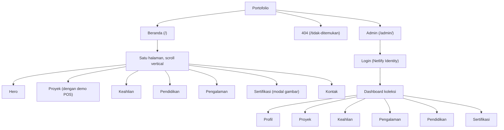
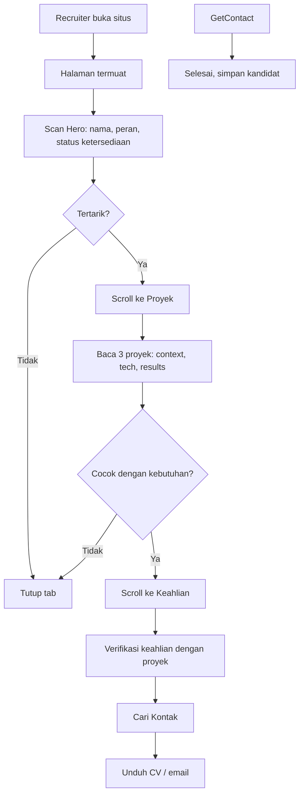
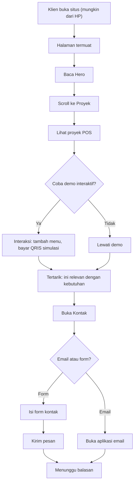
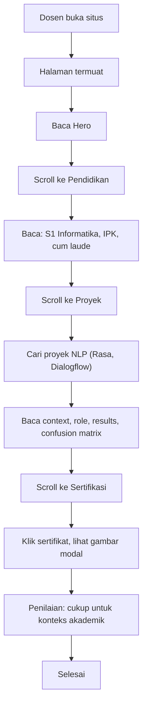
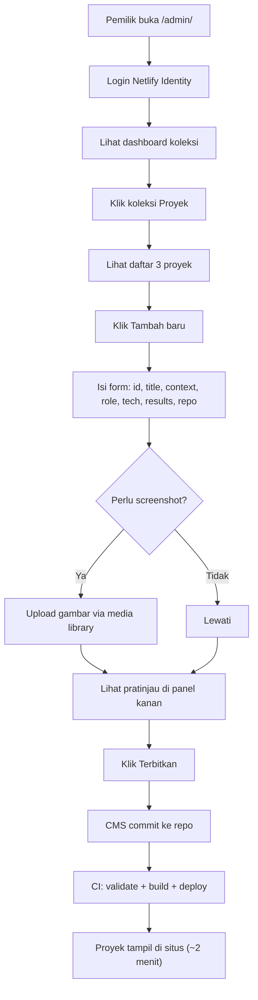
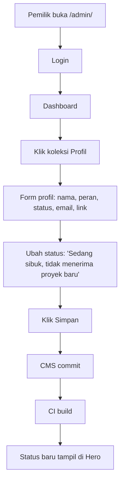
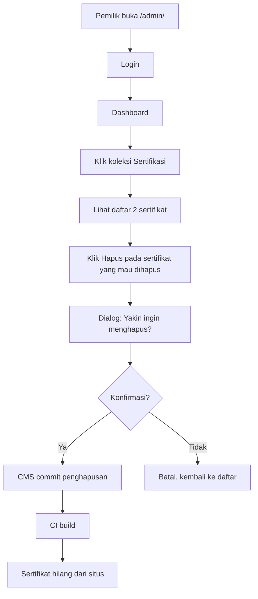
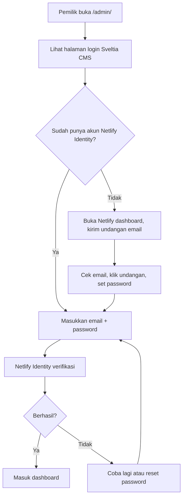

# Sitemap dan Alur Pengguna: Portofolio Dewa Bintang Nugroho

Dokumen ini menjelaskan struktur halaman dan alur pengguna untuk pengunjung maupun pemilik. Status: perancangan.

---

## 1. Sitemap

### Daftar halaman

| URL | Halaman | Untuk siapa | Status |
|-----|---------|-------------|--------|
| `/` | Beranda (satu halaman, 7 section) | Pengunjung | Sudah ada, perlu perbaikan |
| `/admin/` | Admin CMS | Pemilik | Belum ada |
| `/*` (selain di atas) | 404 | Pengunjung | Belum ada |

Catatan: situs tetap satu halaman (single page) tanpa routing client-side. Navigasi pakai anchor link (`#projects`, `#skills`, dst.). Halaman admin adalah single-page app terpisah (Sveltia CMS) yang tidak ikut masuk bundle publik.

## 2. Alur Pengunjung

### 2.1 Flow: Recruiter menilai kandidat

Waktu ideal: 30-60 detik. Yang kritis: Hero harus langsung memberi tahu siapa dan apa keahliannya, tombol CV harus terlihat, kontak mudah ditemukan.

### 2.2 Flow: Klien mencari developer

Waktu ideal: 1-2 menit. Yang kritis: demo POS harus berfungsi di mobile, tombol kontak harus jelas, form (jika ada) harus simpel.

### 2.3 Flow: Dosen/kolega akademik

Waktu ideal: 2-3 menit. Yang kritis: detail pendidikan dan proyek akademik harus lengkap, sertifikat bisa dilihat dengan jelas (modal bug harus diperbaiki).

## 3. Alur Admin (Pemilik)

### 3.1 Flow: Menambah proyek baru

### 3.2 Flow: Mengubah profil

### 3.3 Flow: Menghapus sertifikat

### 3.4 Flow: Login pertama kali

## 4. Titik Masuk dan Keluar

### Pengunjung masuk dari

| Sumber | Harapan | Section yang pertama dilihat |
|--------|---------|------------------------------|
| Google search (nama + "portofolio") | Lihat profil dan proyek | Hero |
| LinkedIn / GitHub bio link | Kenali siapa dan apa keahliannya | Hero |
| Social media share (OG image) | Klik link, lihat situs | Hero |
| QR code di CV cetak | Lihat portofolio digital | Hero |
| Langsung ketik URL | Sama seperti di atas | Hero |

### Pengunjung keluar ke

| Aksi | Tujuan |
|------|--------|
| Klik "Unduh CV" | File PDF diunduh |
| Klik "Email saya" | Aplikasi email terbuka |
| Klik GitHub | Tab baru ke github.com/dewanugroho |
| Klik LinkedIn (jika sudah diisi) | Tab baru ke profil LinkedIn |
| Kirim form kontak (jika ada) | Konfirmasi pengiriman |
| Tutup tab | Selesai |

### Pemilik masuk ke

| Sumber | Aksi |
|--------|------|
| `/admin/` langsung | Login CMS |
| Notifikasi Netlify (build selesai/gagal) | Cek hasil deploy |
| Notifikasi email (pesan form kontak) | Baca pesan di dashboard Netlify |
